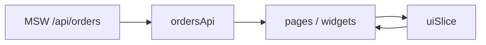

# 13-orders-admin — architecture

## Redux store

`configureStore` combines:

| Slice / reducer | Role |
|-----------------|------|
| `ordersApi` (RTK Query) | Remote orders: list, detail, status PATCH, normalized cache |
| `ui` (`uiSlice`) | Client-only: `statusFilter`, `selectedOrderId` |

Typed hooks: `useAppDispatch`, `useAppSelector` in `src/app/store/hooks.ts`.

## RTK Query vs slice

**RTK Query (`ordersApi`)** owns anything that mirrors the server:

- Fetching and caching `GET /api/orders` and `GET /api/orders/:id`
- Mutations `updateOrderStatus` with `invalidatesTags` so list and detail stay consistent
- Loading / error flags per endpoint hook (`useGetOrdersQuery`, etc.)

Use Query when data has a URL, should be shared across routes, and benefits from tag-based invalidation.

**`uiSlice`** owns ephemeral UI that is not persisted on the server:

- Table status filter (`all` | specific status)
- Last selected order id (for cross-route UX)

Use a slice when state is local to the admin session, updated synchronously, and does not map 1:1 to an API resource.

Other portfolio apps use TanStack Query or Zustand instead; this app is the **only** Redux example.

## Data flow

## HTTP errors

`baseQueryWithAuthHandling` wraps `fetchBaseQuery`. On `401`, it shows a sonner toast (demo via MSW flag on the next request).

## Module Federation

Vite plugin `@module-federation/vite`: remote name `orders`, exposes `./App` for `00-mfe-shell`. Federation plugins are skipped when `mode === 'test'` so Vitest stays fast and isolated.
